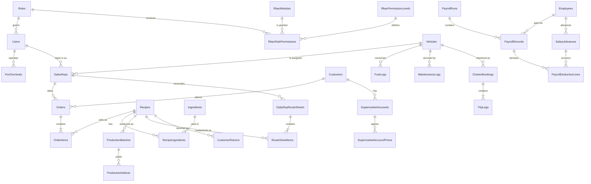

# Manufacture.Database

SQL Server Data Tools (SDK-style) database project that is the source of truth
for the Manufacturing application's relational schema.

The project is built with `Microsoft.Build.Sql` and produces a `.dacpac` that can
be published to SQL Server, Azure SQL, or a local SQL Server LocalDB instance.

## Organisation

All tables live in the **`dbo`** schema and in a single `Tables` folder. This
keeps joins simple (no cross-schema prefixes) and matches the layout used by the
other database projects in the workspace.

```
Manufacture.Database/
├── Tables/
│   ├── Users.sql
│   ├── Orders.sql
│   ├── OrderItems.sql
│   └── ...
├── Scripts/
│   └── README.md
├── README.md
└── Manufacture.Database.sqlproj
```

## Table map

### Identity and access

- `Roles` — system roles (Super Admin, Production Manager, Store Manager, Sales Rep, Vendor, HR & Payroll Manager).
- `Users` — application logins, role assignment, PIN/password hashes.
- `RbacModules` — functional areas shown on the RBAC matrix.
- `RbacPermissionLevels` — permission labels plus their capability flags.
- `RbacRolePermissions` — one role/module permission cell.
- `RbacPermissionAudits` — append-only permission-change history.
- `AuditLogs` — append-only change history.

### Human resources

- `Employees` — staff master record with bank details, employment status, emergency contacts, and guarantor contacts.
- `SalaryAdvances` — staff loans and repayment balances.
- `PayrollSettings` — single-row payroll policy (loan recovery, allowances, PAYE, pension, health).
- `PayrollRuns` — one row per monthly payroll run, with generated date, user, totals, and status.
- `PayrollRecords` — one row per employee per payroll month, linked to a payroll run.
- `PayrollDeductionLines` — itemised deduction ledger (tax, pension, health, disciplinary, loan recovery).

### Product catalogue and inventory

- `Suppliers`
- `InventoryItems`
- `Ingredients` — raw materials priced per unit.
- `Recipes` — sellable products and their baseline-yield costing header.
- `RecipeIngredients` — ingredient lines for one baseline batch.

### Production

- `ProductionBatches` — logged production runs with costing snapshots.
- `ProductionDefects` — factory rejects removed before loading.
- `StoreRequests`
- `StoreRequestItems`

### Sales and route reconciliation

- `Customers`
- `PosTerminals`
- `SalesReps` — field roster, route, POS terminal, and vehicle assignment.
- `Orders`
- `OrderItems`
- `SupermarketAccounts`
- `SupermarketAccountPrices` — agreed per-product prices for an account.
- `CustomerReturns` — prior-sale items returned by customers.
- `DailyRepRouteSheets` — daily rep reconciliation header.
- `RouteSheetItems` — per-SKU loaded, sold, closing-stock, and damaged quantities.

### Fleet and logistics

- `Drivers`
- `Vehicles`
- `FuelLogs`
- `RouteRates`
- `CharterBookings`
- `TripLegs`
- `MaintenanceLogs`
- `WeeklyFleetExpenses`

### Finance

- `TreasuryPolicySettings` — single-row cash/digital tender policy.

## Seeded roles and demo accounts

`scripts/seed-database.sql` inserts the six system roles and one demo account
per role. All seeded accounts use the password `Password123!`.

| Email | PIN | Role |
| --- | --- | --- |
| `admin@bakery.com` | `111111` | Super Admin |
| `production@bakery.com` | `222222` | Production Manager |
| `store@bakery.com` | `333333` | Store Manager |
| `sales@bakery.com` | `444444` | Sales Representative |
| `vendor@bakery.com` | `555555` | Vendor |
| `hr@bakery.com` | `666666` | HR & Payroll Manager |

Passwords and PINs are stored as ASP.NET Core `PasswordHasher` hashes.

## Seeded HR data

The development seed adds:

- **6 employees** across the five departments:
  - Production: `EMP-001`, `EMP-002`
  - Sales: `EMP-003`
  - Logistics: `EMP-004`
  - Store: `EMP-005`
  - Admin: `EMP-006`
- **2 active salary advances** for `EMP-001` and `EMP-004`.
- A **September 2026 payroll seed** for `EMP-001` and `EMP-004`, including the loan recovery deduction lines.
- A single `PayrollSettings` row with:
  - 20% monthly loan recovery
  - 50% maximum loan-to-salary ratio
  - 12.5% housing allowance
  - 6.25% transport allowance
  - 3.5% PAYE tax
  - 5% pension
  - 2.65% health insurance

The monthly loan recovery is a fixed percentage of the **original principal**
(e.g. 20% of ₦60,000 = ₦12,000), capped at the remaining balance for the final
installment. The Payroll Run screen lets the operator override the recovery
amount per employee, up to that employee's total outstanding loan balance.

A payroll run is approved as a whole: `Payroll/Details` is read-only, and the
single **Approve & Release Payroll** action lives on `Payroll/RunDetails`.
Additional payroll records and deduction lines are generated by the
**Payroll Run** page.

## Core relationships



## Conventions

- Tables are plural and PascalCase and all live in `dbo`.
- Every table has an `Id` surrogate key (`INT IDENTITY`), except audit rows
  (`BIGINT`) and the single-row settings table.
- Business keys are protected by unique constraints or filtered unique indexes
  (for example `Users.Email`, `SalesReps.UserId`, `Ingredients.ItemCode`).
- Enum-like columns are `INT` with a named `CHECK` constraint so the numeric
  values match the C# enums in `Manufacture.Library/Models/Entities`.
- Money uses `DECIMAL(18,2)`; quantities use `DECIMAL(18,3)`; unit costs use
  `DECIMAL(18,4)`.
- Derived values that are safe to persist (`LineTotal`, `Variance`,
  `RemainingBalance`, `NetSalary`, and similar) are persisted computed columns.
- Child line tables cascade from their parent header; reference/master tables use
  `NO ACTION` to avoid accidental deletes and multiple cascade paths.
- `CreatedAt` / `UpdatedAt` default to `SYSUTCDATETIME()`; the application is
  responsible for refreshing `UpdatedAt` on updates.
- Aggregate roots that benefit from optimistic concurrency carry `ROWVERSION`.

## Visual Studio

The project targets **.NET 10.0** (`<TargetFramework>net10.0</TargetFramework>`)
so it matches the web and library projects and does not require a .NET Framework
targeting pack.

Every table and README file is listed explicitly in
`Manufacture.Database.sqlproj`. `EnableDefaultSqlItems` is turned off so
Solution Explorer shows the full `Tables/*.sql` tree instead of relying on the
SDK's implicit `**/*.sql` glob.

The project also pins the SQL build tasks to the copies shipped inside the
`Microsoft.Build.Sql` package:

```xml
<BuildFromSSDT>false</BuildFromSSDT>
<SSDTPath>$(NETFrameworkTargetsPath)</SSDTPath>
```

Without this, Visual Studio's SQLDB extension can load its older DacFx task
assembly and fail to initialize `SqlScriptDependenciesTask` (`04063` / `04064`).

`Microsoft.Build.Sql` is pinned to **2.2.0** for Visual Studio 2026
compatibility. Version 2.3.0 passes a `PreplanItem` parameter that the DacFx
task assembly bundled with the Visual Studio SQLDB extension does not expose.
The newer-SDK version check is suppressed with
`SkipCheckForNewSDKVersion`.

## Build

```powershell
dotnet build Manufacture.Database/Manufacture.Database.sqlproj
```

The compiled model is written to `bin/Debug/Manufacture.Database.dacpac`.

## Deploy to LocalDB

The repository includes a helper that builds, creates the database, publishes the
schema, and applies the baseline seed rows:

```powershell
pwsh scripts/deploy-database.ps1
```

Defaults:

- Server: `(localdb)\MSSQLLocalDB`
- Database: `ManufactureDb`

Override them when needed:

```powershell
pwsh scripts/deploy-database.ps1 -Server "localhost" -Database "ManufactureDb_Dev"
```

For a clean development reset (drops and recreates the database):

```powershell
pwsh scripts/deploy-database.ps1 -Recreate
```

`Microsoft.SqlPackage` and `dotnet-ef` are pinned as local tools in
`dotnet-tools.json`; run `dotnet tool restore` after cloning.

## Re-scaffold the EF Core models

After changing the schema, regenerate the DbContext and entities in the class
library:

```powershell
pwsh scripts/scaffold-database.ps1
```

Generated files:

- `Manufacture.Library/Data/ManufactureDbContext.cs`
- `Manufacture.Library/Models/Entities/*.cs`

The hand-written domain models and DTOs remain in `Manufacture.Library/Models`
(`Models/Domain` and `Models/DTOs`).
